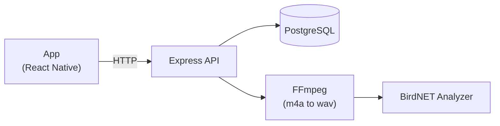
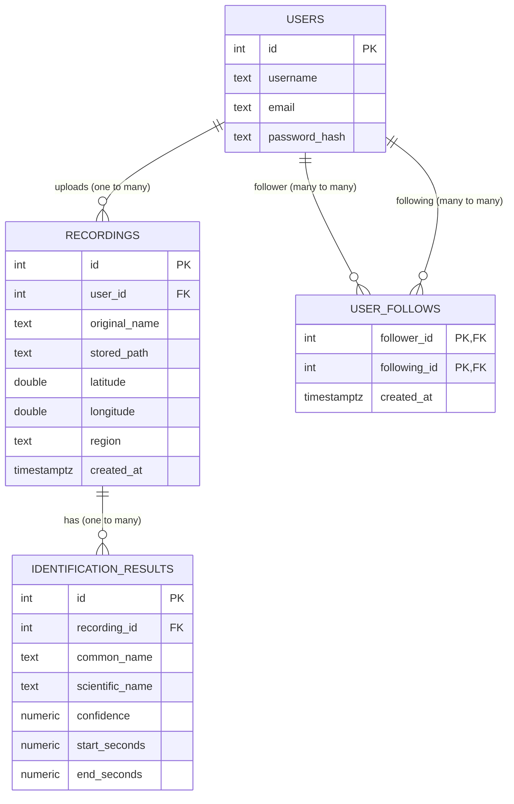

<div align="center">

# Bird ID
**Record Bird sounds to identify them**


</div>

## Table of contents

- [About](#about)
- [Features](#features)
- [Releases](#releases)
- [Architecture](#architecture)
- [Database](#database)
- [Project structure](#project-structure)
- [Getting started](#getting-started)
  - [Prerequisites](#prerequisites)
  - [BirdNET](#birdnet)
  - [Backend](#backend)
  - [Mobile app](#mobile-app)
  - [Building the APK](#building-the-apk)
- [Environment variables](#environment-variables)
- [API endpoints](#api-endpoints)
- [Roadmap](#roadmap)

## About
Bird ID is an app that records bird sounds and identifies them using [BirdNET](https://github.com/birdnet-team/BirdNET-Analyzer) to analyze the sounds and give you the results

## Features

- Bird identification with confidence scores
- Region saved with each observation
- Profile page listing your observations and identified birds
- Bird ids' link to wikipedia
- Search, follow and unfollow other users

## Releases
Check the [releases page](https://github.com/Ilse547/BirdID/releases) to download the latest release.
Current Version: v1.0.0

## Tech stack
Mobile : React Native  
Backend : NodeJS and Express  
Database : PostgreSQ  
Audio analysis : BirdNET Analyzer  

## Architecture

## Database


## Project structure

```text
BirdID/
├── mobile/
│   ├── pages/      # app pages
│   ├── hooks/      # app hooks
│   ├── App.js
│   ├── config.js
│   └── styles.js
├── backend/
│   ├── routes/     # API routes
│   ├── middleware/ # API middleware
│   ├── services/   # API BirdNET service
│   ├── db/         # API DB connection
│   └── server.js
└── birdnet/        # Python virtual environment running birdNET
```
## Getting started
### Prerequisites
- Node.js 20+
- PostgreSQL 17
- Python 3 and FFmpeg
- An Android phone (or emulator)

### BirdNET
```bash
mkdir -p birdnet
python3 -m venv birdnet/.venv
birdnet/.venv/bin/python -m pip install birdnet-analyzer
```
```bash
birdnet/.venv/bin/python -m birdnet_analyzer.analyze --help
```
### Backend

```bash
cd backend
npm install
node server.js
```
> [!WARNING]
> Don't forget to set up the .env

### Mobile app
```bash
cd mobile
npm install
npx expo start -c
```
> [!WARNING]
> Don't forget to set up the .env

### Building the APK
```bash
cd mobile
npx expo prebuild --clean
cd android
./gradlew assembleRelease --no-build-cache
```
The APK will be at:
```text
mobile/android/app/build/outputs/apk/release/app-release.apk
```

## Environment variables

### `backend/.env`

```env
PORT=3000
DB_USER=birdid_user
DB_HOST=localhost
DB_NAME=birdid
DB_PASSWORD=change-me
DB_PORT=5432
JWT_SECRET=use-a-long-random-secret
```

### `mobile/.env`

```env
EXPO_PUBLIC_API_URL=http://<server-ip>:3000
```

## API endpoints

| Endpoint | Auth | Description |
| --- | :--: | --- |
| `/` | ❌ | check |
| `/auth/register` | ❌ | create account |
| `/auth/login` | ❌ | login and receive a JWT |
| `/upload` | ✅ | upload recording to run BirdNET |
| `/recording/me` | ✅ | observations and identifications |
| `/users/search?q=` | ✅ | search users by username |
| `/users/following` | ✅ | followed users |
| `/users/:userId` | ✅ | profile and observations |
| `/users/:userId/follow` | ✅ | follow a user |
| `/users/:userId/follow` | ✅ | unfollow a user |

## Goals:
1. Users should be able to log in to save their recent sightings
2. Users should be able to follow other users and see their sightings
3. users should be able to record their sourroundings and ID birds by their chant
4. users should be be able to share their identifications

## roadmap

- [x] microphone recording
- [x] BirdNET integration
- [x] Express upload route
- [x] mobile upload
- [x] result screen
- [x] Login and registration
- [x] location loging
- [x] Follow users
- [ ] notifications
- [x] see other peoples profiles
- [x] view other peoples observations
- [ ] observation chaching
- [ ] API minimum version
- [ ] add link to psecific observations
- [x] cache observations locally

