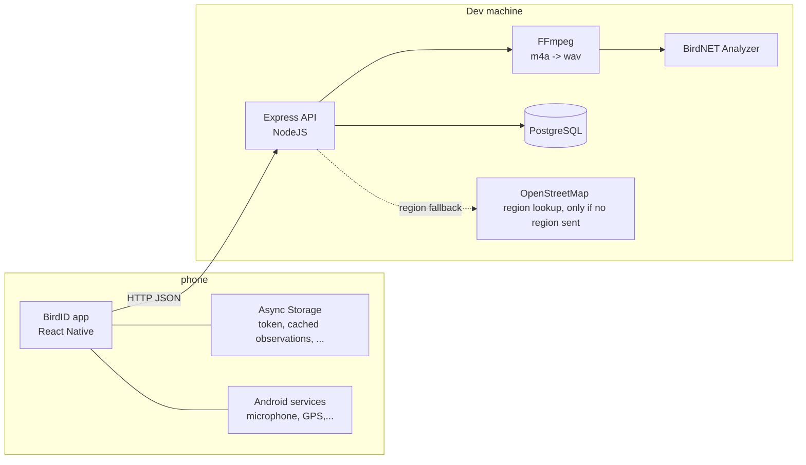

# Birdid architecture
this document described the parts of this project and how they communicate

## components

### Mobile app (`/mobile`)

- Framework: React Native with Expo, plain JavaScript
- Screens (`pages/`):login, register, recording, results, profile, observations, explore, followers, help
- Hooks (`hooks/`): `useBirdRecording` handles microphone recording and gpd,reports blocked permissions
- Local storage: Async storage keeps the login token, the username, and a copy of the users observations for offline viewing, the copies are cleared on logout or when the session expires
- Device features microphone (`expo-audio`), location (`expo-location`), file access (`expo-file-system`)

### Backend(`/backend`)
- Framework: Node.js with Express.
- Routes:
  - `routes/authRoutes.js`: register and login, issues JWTs (valid 12 hours)
  - `routes/userRoutes.js`: search users, list followed users, view a public profile, follow and unfollow
  - `server.js`: upload, own observations, explore, feed, statistics, and app version
- Middleware: `middleware/authMid.js` checks the JWT on protected routes, ity returns 401 when the token is missing and 403 when it is invalid or expired
- Services: `services/birdnetService.js` converts the upload with ffmpeg, runs BirdNET, and parses the result
- Database access: `db/database.js` configured from `backend/.env`.
- Uploads: multer stores each uploaded file in `backend/upload/`.

### BirdNET (`/birdnet`)

- BirdNET-Analyzer runs in its own Python 3.11 virtual environment
- The backend starts it as a separate process for each upload with `--rtype table`
- The output is a tab-separated file: start, end, common name, scientific name, and confidence