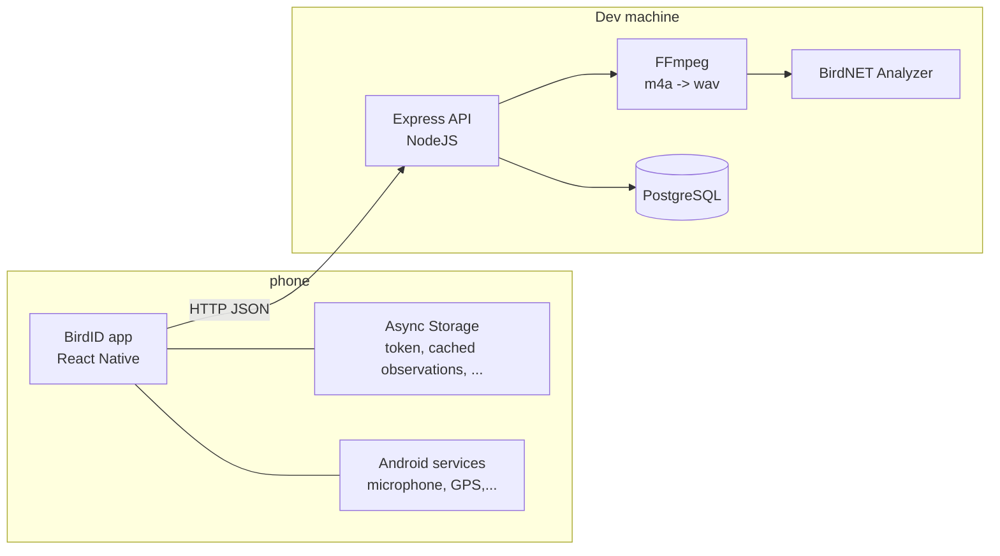

# Birdid architecture
this document described the parts of this project and how they communicate

## components

### Mobile app (`/mobile`)

- Framework: React Native with Expo, plain JavaScript
- Screens (`pages/`):login, register, recording, results, profile, observations, explore, followers, help
- Hooks (`hooks/`): `useBirdRecording` handles microphone recording and gps, reports blocked permissions
- features: microhpne and gps
- Local storage: Device keeps login token, the username, and a copy of the users observation
### Backend(`/backend`)
- Framework: Node.js with Express.
- Routes:
  - `routes/authRoutes.js`: register and login, issues JWTs (valid 12 hours)
  - `routes/userRoutes.js`: search users, list followed users, view a public profile, follow and unfollow
  - `server.js`: upload, own observations, explore, feed, statistics(come soon), and app version
- Middleware: `middleware/authMid.js` and logger (soon to come)
- Services: `services/birdnetService.js` converts the upload with ffmpeg, runs BirdNET, and parses the result
- Database access: `db/database.js` configured from `backend/.env`.
- Uploads: multer stores each uploaded file in `backend/upload/`.

### BirdNET (`/birdnet`)

- The backend starts it as a separate process for each upload with `--rtype table`
- the output is a file with these columns: selection, view, channel, begin time, end time, low frequency, high frequencyy, common name, species code, confidence, begin path, file offset

>[!NOTE]
>The database contains a scientific name collumn, it stores the birdnet species code, for example blutit. will eb adressed at some point.   

## todo