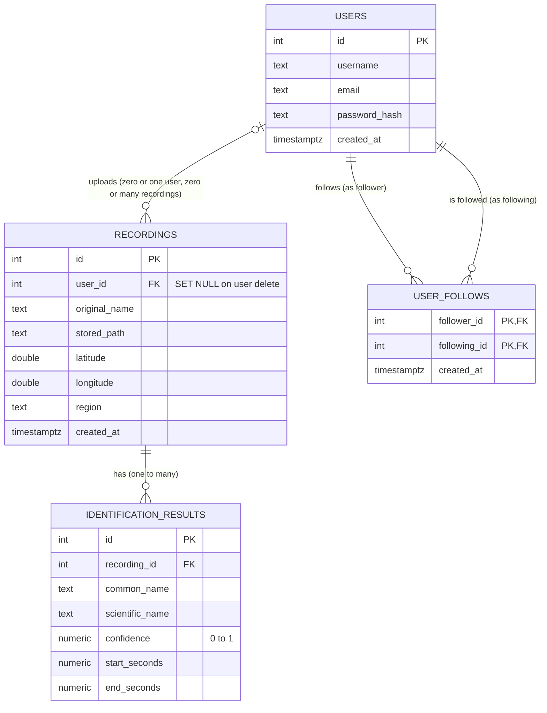

# database
this odcument will describe the database, and the schema

## Data volume
The development database contains mostly seeded data created by 2 programs and one query
```sql
psql -h localhost -U birdid_user -d birdid -c "INSERT INTO user_follows (follower_id, following_id) SELECT f.id, t.id FROM (SELECT id FROM users ORDER BY random() LIMIT 2000) f CROSS JOIN LATERAL (SELECT id FROM users WHERE id <> f.id ORDER BY random() LIMIT 20) t ON CONFLICT DO NOTHING;" && psql -h localhost -U birdid_user -d birdid -c "SELECT COUNT(*) FROM user_follows;"
```
| Table | Rows | Size |
|---|---|---|
| identification_results | 30000000 | 3,380 MB |
| recordings | 3000000 | 405 MB |
| users | 50000 | 12 MB |
| user_follows | 2 | 40 kB |

The total size is about 3.8GB

## Indexes
| Index | Table and column | Supports |
|---|---|---|
| `users_pkey`, `users_username_key`, `users_email_key` | users (id, username, email) | primary key lookups, unique username and email, login by email |
| `recordings_user_id_idx` | recordings (user_id) | a user's own observations (`/recording/me`) |
| `results_recording_id_idx` | identification_results (recording_id) | joining results to their recording |
| `user_follows_following_id_idx` | user_follows (following_id) | finding who follows a user |
| `user_follows_pkey` | user_follows (follower_id, following_id) | finding who a user follows (`/users/following`) and preventing duplicate follows |
| `recordings_created_at_idx` | recordings (created_at DESC) | newest recordings for `/recording/explore` and `/recording/feed`. Reduced explore query time from 80.5 ms to 3.9 ms on 273,426 recordings |
| `users_username_trgm_idx` | users (username, GIN trigram) | `/users/search` (`ILIKE '%q%'`). Reduced a rare-term search from 20.8 ms to 0.12 ms on 46,926 users. Requires the `pg_trgm` extension and only helps with search terms of 3 or more characters |

> Tested performance on `recordings (user_id, created_at DESC)` for `/recording/me` and `/recording/feed` they run in about 1–2 ms with the existing `recordings_user_id_idx` index, adding another index wouldnt improve the performance much

## Tables
### users
| Column | Type |
|---|---|
| id | integer |
| username | text |
| email | text|
| password_hash | text |
| created_at | timestampt |

### recordings
| Column | Type |
|---|---|
| id | integer |
| user_id | integer |
| original_name | text|
| stored_path | text |
| latitude | double precision |
| longitude |double precision |
| region | text |
| created_at | timestamptz |

### identification_results
| Column | Type |
|---|---|
| id | integer |
| recording_id |
| common_name | text |
| scientific_name | text |
| confidence |numeric(5,4) |
| start_seconds | numeric(10,3) |
| end_seconds | numeric(10,3) |

### user_follows
| Column | Type |
|---|---|
| follower_id | integer |
| following_id | integer |
| created_at | timestampt|



from the readme
